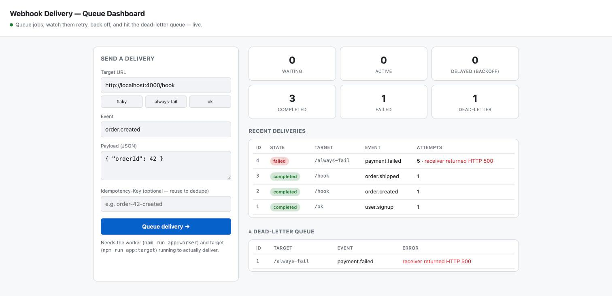

# Learn Message Queues in TypeScript

A hands-on, runnable project for understanding message queues — from building a
tiny queue **from scratch** to running a real feature on **BullMQ + Redis**.

Every phase is a small script you can run and read. No build step: modern Node
runs the TypeScript directly.

## Prerequisites

- **Node.js 22+** (uses native `.ts` execution)
- **Redis** running locally on `localhost:6379` (needed from Phase 2 on)
  ```bash
  # macOS:      brew install redis && brew services start redis
  # Docker:     docker run -d -p 6379:6379 redis
  # check it:   redis-cli ping   # → PONG
  ```

## Setup

```bash
git clone https://github.com/swapnull-in/messaging-queues.git
cd messaging-queues
npm install
```

## The lessons

Run them in order. Each one prints a timestamped log so you can watch what happens.

| Command | What you learn |
|---|---|
| `npm run phase1` | Build a queue **from scratch** — producer, consumer, ack, retry, dead-letter |
| `npm run phase2:demo` | The same app on **BullMQ + Redis** (persistent, distributed) |
| `npm run phase3` | **Idempotency** — safely handling a message that arrives twice |
| `npm run phase4` | **Scheduling** — delayed, repeatable (cron), and rate-limited jobs |
| `npm run phase5` | **RabbitMQ** — exchanges & routing: one event fanned out to many queues |
| `npm run phase6` | **Kafka-style streaming** — the log, consumer groups, offsets, replay |
| `npm run phase7` | **Pub/Sub** — fire-and-forget broadcast (no persistence, no acks) |
| `npm run phase8` | **Priority queues** — urgent jobs jump the line |
| `npm run phase9` | **Outbox & CDC** — the dual-write bug; transactional outbox + change-data-capture |
| `npm run phase10` | **Event sourcing** — state is a fold of events; replay, time-travel, snapshots |
| `npm run phase11` | **CQRS** — split writes from reads; many read models; the read-lag window |
| `npm run phase12` | **Backpressure** — a fast producer vs a slow consumer; block, shed, or scale |
| `npm run phase13` | **Exactly-once purchase** — the capstone: idempotency keys + outbox + reconciliation, end to end *(Deep Dive 23)* |

The code in `src/phase1/queue.ts` is the one to read first — it's the whole
queue engine in ~150 commented lines.

> **Phases 9–12 need nothing installed** — they're dependency-free in-process
> simulations (like Phase 1), so they run on plain Node with no Redis, RabbitMQ,
> or Kafka. They cover the event-driven patterns a Staff interview turns on: the
> transactional **outbox** (the single most important messaging pattern — never
> dual-write to a DB and a broker), **event sourcing**, **CQRS**, and
> **backpressure**.

> **Phase 5 needs RabbitMQ** on `localhost:5672`:
> ```bash
> # macOS:   brew install rabbitmq && brew services start rabbitmq
> # Docker:  docker run -d -p 5672:5672 rabbitmq
> ```
> It shows what a job queue like BullMQ *doesn't* do: publishing to an
> **exchange** that routes one message to many subscriber queues by pattern.
>
> **Phase 6 needs a Kafka broker** on `localhost:9092`. Redpanda is a
> single-container, Kafka-compatible option:
> ```bash
> docker run -d --name redpanda -p 9092:9092 \
>   docker.redpanda.com/redpandadata/redpanda:latest \
>   redpanda start --mode dev-container
> ```
> It shows the log-based model: messages are *retained*, so many consumer
> groups can read (and replay) the same stream at their own offset.

### Two families of tools

- **Job queues** (Phases 1–4, 8; BullMQ) — deliver each message to *one* worker,
  then delete it. For background *work*: emails, webhooks, image processing.
- **Event brokers / streams** (Phases 5–7; RabbitMQ, Kafka, Pub/Sub) — distribute
  *events* to many independent consumers. For *notifying* other systems.

### Phase 2 the "real" way (two terminals)

```bash
npm run phase2:worker    # terminal 1 — the worker, leave it running
npm run phase2:produce   # terminal 2 — sends jobs, then exits
```

## Capstone: a real feature + dashboard

A **Webhook Delivery Service** — an API that accepts requests and returns
instantly, while a worker delivers them in the background with retries, backoff,
and a dead-letter queue. This is the classic reason queues exist.

Run the three parts in three terminals:

```bash
npm run app:target    # a fake, flaky receiver on :4000
npm run app:worker    # the delivery worker
npm run app:server    # the API + dashboard on :3000
```

Then open **http://localhost:3000/** to try it in the browser: send deliveries,
watch them retry and back off live, and see failed ones land in the dead-letter
queue.



Prefer curl?

```bash
curl -X POST localhost:3000/webhooks -H 'content-type: application/json' \
  -d '{"url":"http://localhost:4000/hook","event":"order.created","payload":{"orderId":42}}'
```

## Interactive Queue Lab

Every phase is also a live instrument in the browser — watch a poison job retry
then dead-letter, double-charge a card then dedupe it, race a fast producer past
a slow consumer and pick block vs shed, key messages onto Kafka partitions and
replay the log, and crash a dual-write then fix it with the outbox.

```bash
npm run web        # serves web/index.html at http://localhost:8080 (no deps)
```

One self-contained static page (self-hosted fonts), grouped by tier and
deep-linkable. To host it on **Cloudflare Pages**: connect this repo in the
dashboard with build output `web` (auto-deploys on push), or run
`npx wrangler login` then `npm run deploy`.

## Project layout

```
src/
  phase1/   queue built from scratch (+ demo)
  phase2/   same app on BullMQ + Redis
  phase3/   idempotency
  phase4/   scheduling
  phase5/   RabbitMQ — exchanges & routing
  phase6/   Kafka-style streaming (Redpanda)
  phase7/   Redis Pub/Sub
  phase8/   priority queues
  phase9/   dual-write bug, transactional outbox, CDC
  phase10/  event sourcing (state = fold of events)
  phase11/  CQRS (write model + projected read models)
  phase12/  backpressure (unbounded vs block vs shed)
  app/      the webhook delivery service + browser dashboard
web/
  index.html  ·  serve.mjs   (the interactive Queue Lab — npm run web)
```

## Drill & study guide

The web lab has a **Drill** tab — the matching study module's interview questions
and cheat-sheet one-liners as click-to-reveal cards (active recall: answer out
loud before revealing). [`STUDY-GUIDE.md`](STUDY-GUIDE.md) maps every phase to
the exact module section it implements, with the staff-level insight quoted, and
points to the deep dives to read next.

## License

MIT — see [LICENSE](LICENSE). Use it, fork it, learn from it.
